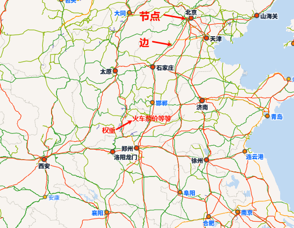
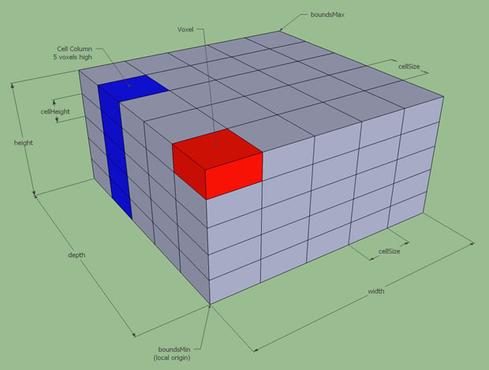
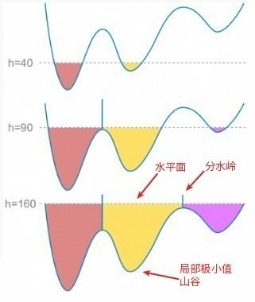
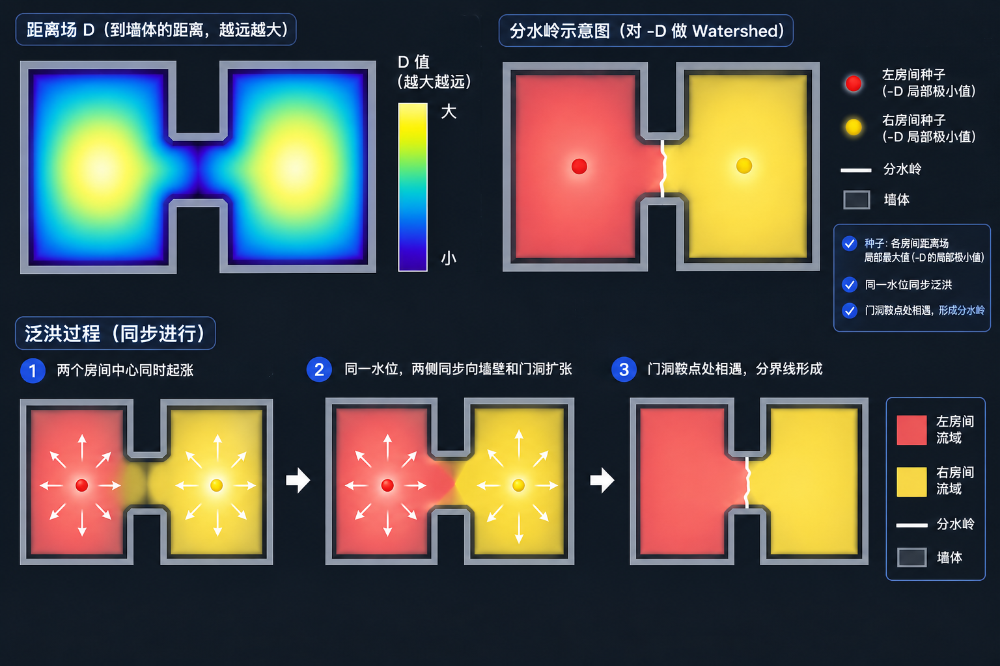
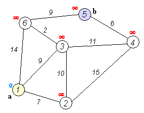
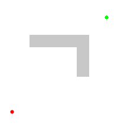
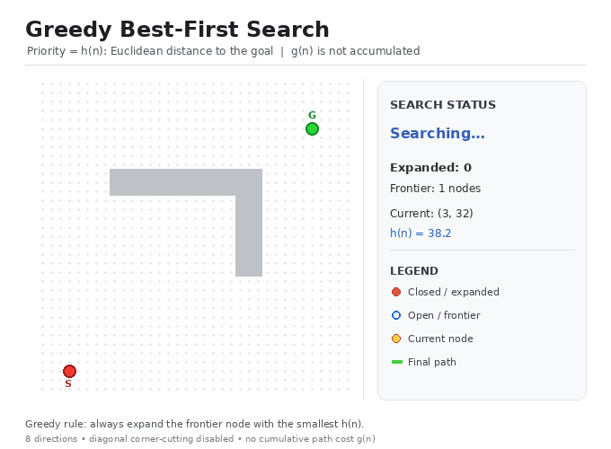
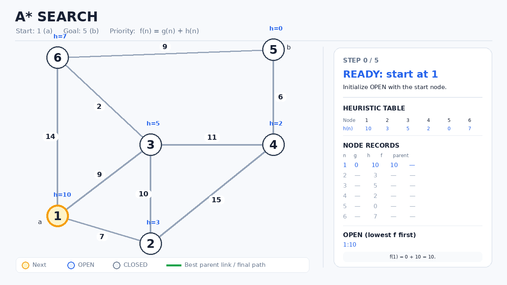
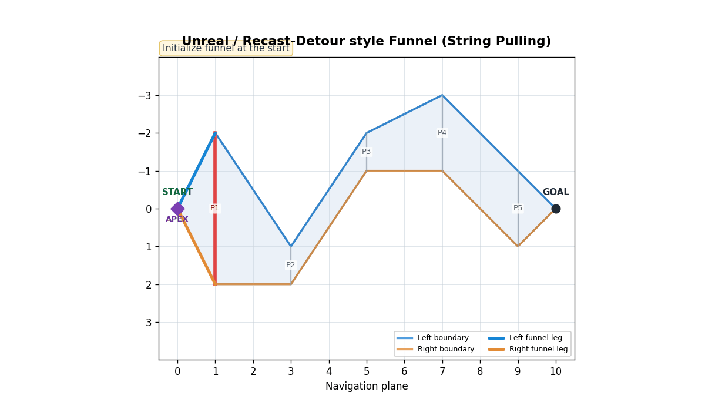

# UE 寻路（NavMesh）原理

注：由于NavmeshXZ方向是水平，Y方向是高度，虚幻又做了转换，避免歧义，本文统一用XY标识水平，Z表示高度。

## 一、世界寻路基本思路
### A、什么是寻路？
寻路，顾名思义，是寻找最短路径。

先从宏观上看这个问题需要什么、最后拿到什么。答案很朴素：三个输入，一个输出——起点、终点、可行走区域，输出的是一条最短路径线段。

起点和终点没什么可说的，就是两个世界坐标。真正撑起这个问题的是第三项。如果不限定可通行的范围，那么「最短路径」毫无悬念就是两点之间直线最短，问题在提出来的那一刻就结束了，也就没有讨论的意义。换成人话说，可行走区域就是我们脚下的可行走地表：哪块能踩、哪块不能踩。

所以寻路这件事，信息量几乎全压在第三项上。算法只决定快慢，可行走区域决定答案对不对。

### B、寻路基本思路
从程序上看，这个问题有一个现成的靠山：图论。最短路径在这个领域沉淀了几十年，Dijkstra、A\* 这些算法现成摆着，只要给它一张图就能跑。
至于图可以用铁路网来类比。


图简单来说可以由三个要素来构成，节点，边，权重，节点就是火车站，边是节点的相连关系，权重是考虑的代价，权重在边上，例如你需要从襄阳到太原，你想要距离最短，那么距离就是权重，你想要火车票钱最短，那么火车票价格就是权重。

所以游戏里真正难的，从来不是「怎么找路」，而是「怎么把一个复杂的三维世界变成一张图」。
也就是游戏里面一整个游戏世界抽象成一张铁路网？
这件事也有一套成熟的模板，结论可以压成三步：

1. 把 3D 世界抽象成一张 2D 的凸多边形图，也就是我们在虚幻寻路里看到的那一片片绿色多边形；
2. 在这张图上套图论最短路径算法，得到一条最短的多边形路径；
3. 再用一个算法，把多边形路径处理成一条线段。

后面所有内容，都是这三步的展开。
## 二、寻路过程
### A、2D 世界转换为图
先从2D世界开始看起。
最早把这件事讲清楚的是机器人领域，用的叫 grassfire algorithm。

它的核心思路是把二维世界处理成一块块相连的凸多边形。为什么是凸多边形？因为凸多边形内部任意两点直线可达，所以在凸多边形内部就可以使用两点之间直线最短去进行连接，所以2D地图中任意两点之间连接的路径就可以转换为两步：
1.找到一个最短凸多边形路径连接起点和终点。
2.凸多边形内部两点之间直线最短。

而最短凸多边形路径就正好可以使用前面的图论解决，凸多边形本身就是节点，凸多边形之间的连接关系就是凸的边，在这个凸多边形图上去使用最短路径算法就可以得到最短凸多边形路径。

接下来要把角色的尺寸塞进几何里。教科书的标准做法是把机器人半径加到障碍多边形上，让障碍长胖，机器人缩成一个点。

（图：大矩形里挖一个小方块，外环套内环）

把障碍处理好之后，整个世界就变成了大环里面套一个小环的形态：外环是一圈边界，内环是障碍。而图论算法要的是「每个面只有一条边界环」，所以还得把洞消掉。

这一步叫拓扑展平，或者叫双向接缝拼接。它做的事很直白：从外环上切一个口子进去，绕内洞走一圈，再原路走出来，把两套本来独立的顶点数组拼成一套连续的。

- 原始外环数组：$O_0 \to O_1 \to \dots \to O_k \to \dots \to O_n$
- 原始内环数组：$H_0 \to H_1 \to H_2 \to H_3$

拼接展开后：

$$\underbrace{O_0 \to \dots \to O_k}_{\text{外环前半段}} \xrightarrow{\text{割入}} \underbrace{H_0 \to H_1 \to H_2 \to H_3}_{\text{绕内洞走一圈}} \xrightarrow{\text{原路走出}} \underbrace{H_0 \to O_k}_{\text{退出接缝}} \to \underbrace{O_{k+1} \to \dots \to O_n}_{\text{外环后半段}}$$

因为是走进去再走出来，接缝上的两个顶点（$O_k$ 和 $H_0$）在数组里会各出现两次。这不是 bug，是「割入再退出」留下的痕迹。展平之后整块区域才是单一简单环，也才满足后面三角剖分的前提——到这一步，我们才真的拿到了一张可以跑图论的图。

最后是消凹。做法很直觉：找到凹角，做角平分线也行，把角的一边延长去相交也行，一刀切两半，多边形就凸了。做完就能跑最短路径算法。

需要说明的是，在这套管线里消凹并不是一道独立工序。它被并进了后面的「三角剖分 + 合并」——三角剖分天然消灭所有凹角，合并时又只允许合成凸的。所以代码里找不到任何一个叫「消除凹多边形」的函数。

### B、3D处理分析
2D 到这里就算解决了。可 3D 呢？
借助2D的思想很自然会想到两条路：一条是把整个世界切成很多凸多面体，另一条是把 3D 世界部分转化成 2.5D，再套用前面的方法。Navmesh 选的是后者。
为什么选择后者？
**凸多面体分解本身也不便宜。** 二维简单多边形能线性时间三角剖分；三维即使只求「切成凸块」、不问块数最少，下界已是 $O(n^2)$，要求块数最少则 NP-hard。工程上只能近似分解，而「不保证凸、不保证邻接精确」恰好把 A\* 的正确性前提破掉。它还必然引入新顶点——正是 2D 里放弃凸分解改耳切的同一个理由，浮点裂隙会回来，而 3D 没有「两耳定理」那种保底。

**2.5D 丢的东西有补偿。** 它只丢「同一水平位置只能一层」：多层由 multi-layer heightfield 与 layers 表达，跳跃、落窗、爬梯由 off-mesh link 表达。房间、走廊、楼梯、平台、坡道本质是水平面加竖直墙，2.5D 对它们是精确覆盖。作者在 Readme 里写的也是 multi-layer heightfield，然后仍然「把可行走区域划分成简单叠加的二维区域」——明知多层，还是压回 2D 去分区造图。

代价也要说清：垂直信息被压进层里，层一多生成与查询都变复杂；斜面靠 detail mesh 补高度；真正的三维自由空间（飞行、水下、零重力）它表示不了，那类需求该自建三维采样图或 BVH 体积寻路。

前面说 2D 要考虑机器人宽度，去障碍那边做扩张。角色也一样，只是方向相反——在某个阶段把可行走区域往内收，然后角色依旧简化成一个点。

但角色的「走得过去」远不止宽度一个条件。半径决定能不能从两堵墙之间挤过、边缘能站多靠外；高度决定头顶要留多少净空才钻得过去；步高决定多高的台阶能直接跨上去；可行走坡度决定多陡的斜面算能走。

不过这些处理分散在navmesh的各个过程之中，我整理一下。

| 参数 | 影响什么 |
|:--|:--|
| 半径 | 两墙之间的通过能力、边缘可站范围 |
| 高度 | 头顶净空门槛 |
| 步高 | 可跨越的台阶高度 |
| 坡度 | 可通行斜面陡度 |

这些同样是「在收集信息、构建可行走区域的过程中」就把区域收紧。

为什么非要放在构建期，而不是查询时再判？因为如果在查询期剔，A\* 每展开一个节点都要重算一遍「这个体型能不能站」，等于把几何判断塞进热路径。构建期一次算好，图里每个节点就天然只包含该体型可行的位置。

代价也很清楚：一个体型一套 NavMesh。这就是虚幻支持多个受支持体型的原因。

顺带也就解释了那个常见现象——平台上有些边缘没有被绿边覆盖。不是那里站不住人，而是角色的中心点站不到那么靠外的位置。
### A、逐参数落点（都带判据式）

| 参数         | 落点                                                                                                                                        | 作用对象                             | 真实判据                                                                                     |
| ---------- | ----------------------------------------------------------------------------------------------------------------------------------------- | -------------------------------- | ---------------------------------------------------------------------------------------- |
| **坡度**     | `rcMarkWalkableTriangles`  <br>`Recast/Recast.cpp:356-381`                                                                                | **三角形**，在体素化之前                   | `norm[1] > cos(walkableSlopeAngle)` → 标 `RC_WALKABLE_AREA`，否则该三角形只当障碍光栅化                 |
| **高度（净空）** | `rcFilterWalkableLowHeightSpans`  <br>`Recast/RecastFilter.cpp:231-255`                                                                   | **span 列**                       | `top - bot < walkableHeight` → `area = RC_NULL_AREA`；`bot` 是本 span 顶，`top` 是上方最近 span 的底 |
| **步高**     | ① `rcRasterizeTriangles(..., walkableClimb, ...)`  <br>② `rcFilterLedgeSpans`  <br>③ `rcBuildCompactHeightfield(..., walkableClimb, ...)` | span 列 + 相邻 span 的**邻接关系**       | 相邻 span 高度差 ≤ `walkableClimb` 才建立 `rcGetCon` 连通；低垂薄障碍按 climb 判“能不能跨过去”                   |
| **半径**     | `rcErodeWalkableArea`  <br>`Recast/RecastArea.cpp:36+`                                                                                    | **compact heightfield 的 XY 四邻域** | 在 XZ 上做距离场，`dist < walkableRadius` 的 span 直接标 `RC_NULL_AREA`。**完全没有 Z方向参与**              |

### C、虚幻世界的3D处理
往下是具体流程。

1. 先把一整个世界的区域分割成很多小方块，也就是体素化；
	然后拿体素小方块和碰撞数据的三角形做相交检测，确定哪些体素有三角形——不足一个体素也按一个体素算；
	根据「有三角形的体素」算出「有空间的体素」，筛选出可行走区域，去掉不可行走的部分；
2. 体素化转化为三角形。
	 体素数据转化为高度场数据。
	 高度场数据转化为凸多边形数据
		 进行分水岭算法划分区域,取分水岭边界的点做多边形。
		 耳切法进行多边形三角形分解，并合并三角形。
3. 三角形进行A* 算法得到三角形路径。
4. 对三角形路径去进行漏斗算法把三角形处理成线段路径。

第三点也有个反直觉的地方：一块地板在拆分过程里会被扫出两段几何，下地板面和上地板面。地板内部之所以不能走，不是因为它被判成了障碍，而是这两段之间的净空低于角色身高，在筛选这一步被剔掉了。

#### 1、体素化
##### [1] 体素化的过程
体素化简单来说就是把一整个世界去分割成一个一个的3D小方块，这就是寻路程序去感知3D世界的方法。

在虚幻中就是把物理的三角形数据去切割成一个个小方块。

Navmesh 的作者是参考 Z-Buffer，提出这套体素化处理的。

Z-Buffer 给的启发是：光栅化要处理成千上万个互相遮挡、相交的三角形时，从来不去解三角形之间的解析相交线，那是一场浮点灾难；它直接把三角形打碎成离散的深度像素，让遮挡在像素域用深度测试结算。

体素化是同一个思路：把世界打碎成一个个小块，再把小块重新融合成一套新数据，然后才进入下一步。

这就带出一个很关键的结论——最后寻路用的 3D 到 2.5D 数据，来源是这套处理过后的体素数据，而不是程序里现成的物理数据或渲染数据。原因有三层：它们本来就不是为寻路准备的，渲染关心法线 UV LOD，物理关心精度和连续碰撞，谁都不回答「这块能不能站人」；面与面之间有缝隙、有重叠，地板拼接处的微小缝隙会被误判成不可走，重叠又会让净空算错；再加上不同资产的空间朝向和细分密度并不对齐，没法做统一的空间查询。

而先搅碎再粘合，等于把所有三角形输入归一化到同一个栅格上，后面才有「融合重叠」「按净空过滤」「按距离腐蚀」这些统一动作可言。不过注意，虽然我这样说了，但是其实只有在Z高度方向才有合并的算法,并且只有缝隙不超过一体素的才会合并，主要还是为了消除重叠，XY平面其实并没有合并的这个操作纯粹是通过相邻连接关系去处理的，后面再说。

由此也会有一个工程后果：如果动了一下地图不等于改了导航网格，中间还需要去经历繁琐的12345步骤去进行图的更新。在这种情况下我们就需要一种处理方法去减轻这种代价。
##### [2] 更新的优化
为了扛住庞大的世界数据、避免每次改动都全量更新，还有两个个配套机制。

第一是八叉树。先取物理数据，存进一棵大的八叉树里，节点用数组实现、子节点用索引指向，配一个空闲链表做复用。每个节点上挂 AABB 范围和一份共享引用的几何数据——同一份几何可能被多个瓦片、多个生成任务同时读，共享引用既不拷贝，又保证最后一个使用者释放前不销毁。

第二是瓦片分块。世界切成一块块 tile，瓦片是增量更新的最小单位：一个瓦片重建，就是一次局部体素化、分区加造图。瓦片之间要有重叠边界，否则交界处会出现裂缝或者假墙。当某块tile检测到有更新，比如 actor 被生成、Transform 变了，就把它标脏，然后由管理者用 AABB 相交和共享指针，取出受影响的一小块去重建。

不过瓦片更新由RuntimeGeneration的参数决定。
|档位（ini 里 `RuntimeGeneration` 的取值）|几何|运行时重建什么|成本量级|运行时失效面|
|---|---|---|---|---|
|**Static**|编辑器 bake 死，数据随关卡存盘|什么都不重建，只反序列化 + 建查询结构|≈0（只剩内存与加载时间）|运行时放墙、开门洞、可破坏物、程序化生成**全部不更新**，NavMesh 仍“记得”旧墙。AI 会撞上去，或对着空气绕路|
|**DynamicModifiersOnly**|几何固定、烘焙死，不允许新增或移动实体几何|只重算受影响 tile 的 **Area 标记**：门开/关、禁区启用/停用、代价区。不做体素化/轮廓/多边形|比完整 tile 重建低 1~2 个数量级|只覆盖“原本就存在、只是可通行性会变”的东西。要真的凿出一个洞、挪一堵墙，它做不到|
|**Dynamic**|任意时刻可变|标脏区域内的 tile **完整重建**（上表整条链路跑一遍）|每次标脏 = 一次局部烘焙|成本取决于“一次操作标脏多大面积、多少 tile”。没有预算就会卡 worker、把内存耗掉|

##### [3] 体素化的程序实现

虽然我前面说的体素化是整个世界去切成一个个小方块，但是实际上在程序上面并不是这样实现的

只有XY方向上才是一个个真的小格子，然后在Z方向上并没有真的分成格子，而是用一个整数乘以Z方向上的格子高度来进行表示的（不足一格的按一格来算），
所以实际上在程序上这个体素化更像一个个柱子。

随后在XY方向上分好这个柱子之后，会让这个柱子与碰撞数据的三角形去做相交检测。不过并不是这个柱子去找三角形，而是让有明确坐标的三角形去通过它自己的坐标去找到坐标范围内部的柱子，与之相交并找到相交的柱子向内部写入链表数据，至于为什么是链表，因为要执行我之前说的合并逻辑，而链表的合并很方便。

要记住一点：它记录的是三角形的相交。而地板这种几何，在拆分中会被扫成下地板面和上地板面两段。

```cpp
struct rcSpanData
{
    rcSpanUInt smin : RC_SPAN_HEIGHT_BITS;  // 下界
    rcSpanUInt smax : RC_SPAN_HEIGHT_BITS;  // 上界
    unsigned int area : 6;                  // 区域 id
};
```

两个细节值得单独提。一是 smin 和 smax 是位域，不是两个完整的 int，世界高度被量化到固定比特位里——这是能扛住超大世界的前提。二是 area 那 6 个 bit 不是「走 / 不走」的布尔，而是区域 id，不可走只是其中一个特殊值，其余 id 留着给后面做代价加权用（沼泽更慢、危险区绕行都靠它）。

融合的触发条件是**同一根柱子内、高度区间重叠**。两个限定都要记牢：不跨柱子，比较的也只有高度，X/Y 方向一概不管。

源码里就一句话：`int idx = x + y*hf.width;` 之后只在这条链表上走，判据是两段区间的相交关系——`cur->smin > s->smax` 说明插入点到了，`cur->smax < s->smin` 说明还要往下找，剩下的情况才是重叠。纯一维比较，没有任何几何求交。

关于这个链表：

```cpp
struct rcSpan
{
    rcSpanData data;
    rcSpan* next;   // 同一柱内更高的下一段
};
```

用链表就是因为融合方便——重叠的两段要能立刻拼起来，链表插删正是如此。链表按 smin 升序，插入的时候顺手就排好序了；合并就是把两段取并集，smin 取小、smax 取大。逻辑上是链表，物理上内存是池化的，成批分配，链表只是为了让融合好写。

这样就将一整个碰撞的三角形处理成了一个个小柱子，并且这个小柱子会把有三角形的部分标记好，以供下一步使用。

#### 2、体素数据转化为高度场

##### [1] 体素转化为高度场

这个时候这个高度场其实就是可行走空间的一个表示。

每个格子的 XY 坐标，加上可行走空间的地表y，可行走空间的高度h标识可行走空间。

融合之后会计算不同Span之间的Smin以及Smax之间的高度差，如果这个高度差大于角色的高度，那么就拿出这些数据，然后取这个底下的Smax以及高度Y作为可行走地表。并赋予到新的结构中：

```cpp
struct rcCompactSpan
{
    rcSpanUInt y;        // 地表高度（原来的 smax）
    unsigned int con;    // 四邻连通性：哪几条边能走
    unsigned short reg;  // 区域 id
    unsigned char h;     // 从 y 往上的净空高度
};
```

按这个逻辑往下推，会有个有意思的现象：一块大的石头、或者别的障碍物，它内部也会生成 Navmesh，因为它只认三角形表面。虚幻在这件事上做了特殊处理，靠两样东西把无用面积筛掉——法线和剔除孤岛。

这两件事其实分属不同阶段，容易混成一句「后处理」。法线是在光栅化之前就生效的，坡度超限的、朝下的三角面根本进不来，石头的侧面和底面在这一步就被挡掉了；剔除孤岛是在分区之后，按面积把太小的区域丢掉或并掉，处理的是封闭空腔、夹缝里的碎块。而石头的顶面只要够平够大，确实会生成绿色多边形——这不是 bug，人真的能站上去。

一个格子的区域这样就算处理完了。每个格子的 XY 坐标，加上它的 y 与 h，聚合起来就是一整张高度场。原来那堆体素数据，到这里变成了 2.5D 的高度场。

而这个0.5D的Z方向的分层，例如同一个XY格子上的一楼以及二楼，落到的结构是这样的：

```cpp
struct rcCompactCell
{
    unsigned int index : 24;   // 第一段 span 的下标
    unsigned int count : 8;    // 这一格有几段（几层）
};
```

多层楼就是同一个 XY 柱子，每段各自有自己的 y 和 h，各自判连通、各自进区域。

##### [2] 高度场数据转化为凸多边形数据

###### （1）分水岭算法

高度场是一大堆能走的格子，但图论要的是有限个区域节点,我们需要的是多边形，同时三角形划分这一步也要去掉整片区域里类似空洞的部分，所以还得先分区，然后把区域变成多边形。

随后去对多边形去进行凸多边形化，先耳切法进行多边形分解，将多边形变成三角形，随后合并三角形形成凸多边形图。

分水岭的直觉很好懂：整个世界开始涨洪水，两股水遇到一起的地方，就是分水岭，水从低到高开始涨，山脊就会是分水岭。



不过在虚幻里，判断的依据不是高度，而是这个格子到墙的距离，而且是从大到小变化。



于是整个算法的逻辑就是：从房间中间开始涨水。房间正中间离墙最远、距离最大，最早被淹；墙边和门洞离墙近、距离小，最后才被淹到。所以两个房间的水一定在门洞附近相遇——大致的分水岭，就是门口或者两个房间之间的通道中间。

这样切的好处很直接：它总是在窄处下刀，而窄处恰恰是凸多边形分解最省边的地方。

具体过程是：距离墙壁的距离不断变小，同时给每个格子标上它属于哪一组，直到某个距离上，同一个格子同时属于两组——这个格子就是分水岭。切完，分区就出来了。

这里要区分两个方向，很容易写混。水位是从大到小变的，但代码里的扫描是逐行进行的，一行一行往上走。「从高到低」只描述水位，不描述扫描。

###### （2）取分水岭分区边界做多边形

分区给出的是「哪些格子属于同一块」，接下来要把块变成多边形,也就是取点，他会通过不同的方向去取不同的边缘格子角点。

随后就是这个取点的程序过程，按照方向遍历，每一轮先看当前格子的四个方向里，哪一个方向被标成了“边界”，然后**按这条边记下它的一个端点**：

1. 当 **−X（左）** 方向没邻居、也就是格子**左边**是边界时，就沿着左边从下往上走，记录左边线的上端角点 **(x, z+1)**。
2. 当 **+Z（上）** 方向没邻居、也就是格子**上边**是边界时，就沿着上边从左往右走，记录上边线的右端角点 **(x+1, z+1)**，即右上角。
3. 当 **+X（右）** 方向没邻居、也就是格子**右边**是边界时，就沿着右边从上往下走，记录右边线的下端角点 **(x+1, z)**，即右下角。
4. 当 **−Z（下）** 方向没邻居、也就是格子**下边**是边界时，就沿着下边从右往左走，记录下边线的左端角点 **(x, z)**，即左下角。

同时也需要提一下，这个遍历并不是常规的递归方向移动，然后撞到「墙」就转弯，它是提前就算好了各自的邻居，并且存储起来，只需要遍历一遍所有格子，然后取看它的提前存储好的邻居就好了。

说到这里会有个疑问：格子的 y 说地面在这儿，它凭什么这么说？这个点真的落在现实世界那个地表上吗？

其实并不是一定在地表，会有一个体素内的误差。

但是来源其实站得住。光栅化本质就是判断格中心这个采样点有没有落在三角形里，一旦判定落进去了，高度不是猜的，而是用三角形平面或者边的线性插值，在这个 XY 上算出来的——那一刻它确实就是真实地表高度。

问题是算完马上就要量化。浮点值按 ch 取整，变成「第几个体素」，原来的小数被扔掉。所以从这一刻起它就是一张台阶表，误差上限一个 ch，再也回不去了。

出多边形的时候，角点高度取的是「当前格和三个邻居格里最大的 y」，不是取平均。这是个有意的选择：宁可把角点抬一层，也不能让它低于任何一个相邻格，否则多边形会陷进地面，角色走过去就被判在地下。

多边形本身还是平的，于是又补了一层 detail mesh。它以多边形顶点作种子，在高度场里 floodfill 出一小片高度，按 sampleDist 的间距采样，采样点带一点哈希抖动，免得出现规则网格的条纹；误差超过 sampleMaxError 就往里插顶点，一直贴到够近为止。不过它采的仍然是层号乘 ch，不是原始三角形。

真正连续的高度要到查询时才出现。getPolyHeight 不读层号，而是在 detail 子三角形里做点到三角形的高度插值，输出的才是连续值——角色贴地走，用的就是它。

所以这件事得说得准一点：它保证不了多边形顶点精确落在地表上，能保证的只是这个格子的高度来自真实三角形。多边形是台阶状近似，误差量级就是一个 CellHeight；连续贴地靠 detail mesh 加查询插值补，精度由 DetailSampleDist 和 DetailSampleMaxError 控制。

还有一点得记住，detail mesh 不会回头去找原始三角形，它只读高度场里的 span 和区域标记，所以只能在已经被量化的高度上插值。CellHeight 一旦调粗，斜坡变成阶梯，detail mesh 也救不回来——这也是为什么这个参数改的不只是分辨率，而是整个高度近似的粒度。

###### （3）耳切法

先说耳切法本身。它很朴素：遍历整个多边形，不断找出凸出来的顶点（也就是「耳朵」）切掉，去掉一个点，连接原来的两个点，最后剩下的那个多边形，把切掉的边补回去，整个多边形就被分成了三角形。

其实未必非要三角形，凸多边形就够用。但作者是先用耳切切成三角形，再合并回凸多边形的，原因在他的博客里对比过。AI告诉我这也是凸多边形分解行业通用做法，就是先分解成三角形，然后合并三角形。

| 对比项 | 凸分解 | 三角剖分 |
|:--|:--|:--|
| 时间复杂度 | 高 | 低 |
| 新交点 | 容易出现，随后是浮点精度问题和裂隙 | 不引入 |
| 可行性 | 有失败分支 | 有定理保证 |
| 可逆性 | 难 | 局部可逆 |

原因
有一条定理：任何无自交的简单单环多边形，百分之百可以被三角剖分，而且不会引入新的交点，并且是局部可逆的。凸分解则相反，它可能产生新的交点，一旦有了新交点，浮点精度问题就回来了，裂隙也跟着回来。

还有一条更本质的理由：一个面是由三个点构成的。四边形在非共面或者凹陷的情况下，可能就无法真实地表现游戏里的可行走地表了。

这样每个分水岭区域的多边形就出来了。然后对这个多边形跑耳切，切成三角形；再做三角形的合并，把数量降下来——不合并的话图会太大。

合并时用「多边形顶点数最多为 6」来限制。这个 6 不是经验数字，是底层数据的顶点数组按 6 个定长分配决定的，超了就放不下。

最终得到的就是跑 A\* 的那张图。

有两点需要澄清。第一，最终产物是凸多边形图，不是三角形图——三角形只是耳切之后、合并之前的中间态。第二，这张多边形图只负责拓扑与连通，真实高度由另一层高度细节网格兜着，所以绿多边形看起来是平的，角色走在斜坡上却不悬空。


#### 3、A* 算法

对于A* 算法我们先看一下它的核心评估函数

它的核心评估函数是

$$f(n) = g(n) + h(n)$$

$g(n)$ 是已知代价，也就是从起点走到这里实际花了多少；$h(n)$ 是启发函数，是对「从这里到终点还要多少」的估算。它们合成了一整个路径的长度估计，用这个评估这个路径是否是最短路径。

对于A* 算法，我们先介绍一下一个算法，Dijkstra算法以及 Best-first search 算法，A* 算是二者的结合。

##### [1] Dijkstra 算法

简单来说这个算法就是通过不断取局部最优解，也就是如果遇到岔路，左边离起点6m，右边离起点10m，那我就走左边更短的一边，一直这样走，直到找到终点，注意是离起点的距离，而不是更加符合直觉的走一步的距离。

它是对已知条件的计算，并取最小值。可以对应f(n) = g(n)部分。

可以看一下这个图。



这个算法的关键就是维护一个从起点到所有点的最短路径。
具体过程如下:
先所有节点都标无限大。

| 节点  | 1     | 2   | 3   | 4   | 5   | 6   |
| --- | ----- | --- | --- | --- | --- | --- |
| 距离  | **0** | ∞   | ∞   | ∞   | ∞   | ∞   |
|     |       |     |     |     |     |     |

---
第一步:从起点开始广搜，遍历所有相连节点，写入1到相连节点的距离。

这个时候我们会找到一个最小值，7，我们就可以确定从起点1到节点2的最短距离就是7。为什么呢？

因为如果我不走这条从1到2的路，而是从其他节点绕路重新到2，例如`1–3-2`，那么这个数一定大于 `1–3` 也就是9，同理，走6的话一定大于`1–6` 14，所以1-2一定是从1到2的最短距离，

松弛 `1–2`、`1–3`、`1–6`：

| 节点  | 1     | 2   | 3   | 4   | 5   | 6   |
| --- | ----- | --- | --- | --- | --- | --- |
| 距离  | **0** | 7   | 9   | ∞   | ∞   | 14  |
|     |       | 最短  |     |     |     |     |

---

第二步:我们走到2这一个节点，再次广搜，得到从 `1–2`再到3456的距离，更短就在表格里面替换，大于现状就维持现状。和第一步同理，我们可以找到一个除了我们已经确定最短的2的最短值，也就是3对应的9，这个时候，我们就知道`1–3`也是最短路径。

松弛 `2–3`、`2–4`：`2→3` 得 17 > 9，不改；`2→4` 得 22。

| 节点  | 1     | 2     | 3   | 4   | 5   | 6   |
| --- | ----- | ----- | --- | --- | --- | --- |
| 距离  | **0** | **7** | 9   | 22  | ∞   | 14  |
|     |       | 最短    | 最短  |     |     |     |

---

第三步同理继续，走到3继续。

松弛 `3–6`、`3–4`：`3→6` 得 11 < 14，改；`3→4` 得 20 < 22，改。

| 节点  | 1     | 2     | 3     | 4   | 5   | 6   |
| --- | ----- | ----- | ----- | --- | --- | --- |
| 距离  | **0** | **7** | **9** | 20  | ∞   | 11  |
|     |       | 最短    | 最短    |     |     | 最短  |

---

第四步走到6继续

松弛 `6–5`：`6→5` 得 20。

| 节点  | 1     | 2     | 3     | 4   | 5   | 6      |
| --- | ----- | ----- | ----- | --- | --- | ------ |
| 距离  | **0** | **7** | **9** | 20  | 20  | **11** |
|     |       | 最短    | 最短    |     |     | 最短     |

---

第五步继续

松弛 `4–5`：`4→5` 得 26 > 20，不改。  
（此时 4 与 5 都是 20，先取谁都不影响结果，这里按节点编号取 4。）

| 节点  | 1     | 2     | 3     | 4      | 5   | 6      |
| --- | ----- | ----- | ----- | ------ | --- | ------ |
| 距离  | **0** | **7** | **9** | **20** | 20  | **11** |
|     |       | 最短    | 最短    | 最短     |     | 最短     |

---

第六步

松弛 `5–4`、`5–6`：两端都已定案，无更新。表不再变化，算法结束。

| 节点  | 1     | 2     | 3     | 4      | 5      | 6      |
| --- | ----- | ----- | ----- | ------ | ------ | ------ |
| 距离  | **0** | **7** | **9** | **20** | **20** | **11** |
|     | 最短    | 最短    | 最短    | 最短     | 最短     | 最短     |

---

 最终结果与路径还原

|终点|最短距离|路径|验算|
|---|---|---|---|
|2|7|1 → 2|7|
|3|9|1 → 3|9|
|6|11|1 → 3 → 6|9 + 2 = 11|
|4|20|1 → 3 → 4|9 + 11 = 20|
|**5 (b)**|**20**|**1 → 3 → 6 → 5**|**9 + 2 + 9 = 20**|

但是我们观察这个算法的过程，我们会发现它还是广搜，并且是一个不断取从起点出发走了多远的局部最优解的广搜，通俗一点来讲，从起点来算，哪个节点离起点近我就先往哪走,所以不可避免的，它一定是圆形扩展的，那么这种情况下如果世界很大，这个代价就是不可接受的，这种情况在游戏世界更加常见。



##### [2] Best-first search 算法

这个算法也是不断取局部最优解，不过评估函数不一样，它是记录这个点到达终点的直线距离,去找离终点比较近的路线，你会发现这个Best-first search以及Dijkstra正好互补了，二者加起来就正好是起点到终点的距离，这也就是A* 算法.

它对应h(n)启发函数，它是对未来未知代价的预判与估计，为什么是估计？因为未来的路径是未知的，它可能前面有很大一堵墙，也可能有一座山，也可能能直接走过去，在这种情况下，我们取两个点的直线距离当然只能算是估计。

而这个启发函数怎么估计这个值呢？为什么是直线距离？可不可以不是直线距离？这个有学者进行过研究，关键留到A* 算法再描述吧。

那在一般的图就可以遍历整个图，然后记录下所有节点到终点的位置，然后从起点走最小的，然后继续，直至找到终点，不过这个过程最后找到的未必是最优解。




##### [3] A* 算法




###### （1）A* 的本质

A* 的本质，是利用「最短」这个有序条件，对遍历做裁剪，对于太长的路径无限延后。

换成一句大白话：

如果你这条路线即使按照最乐观的情况计算，最终成本都已经比我目前找到的完整路径更高，那么你就不可能比我更好，我就没有必要继续探索你了。

它的核心评估函数是：

$$\boxed{f(n)=g(n)+h(n)}$$

- `g(n)`：已知代价，也就是从起点走到这里实际花了多少。
    
- `h(n)`：启发函数，是对「从这里到终点还要多少」的估算。
    
- `f(n)`：综合评估值，也就是从起点经过当前节点到达终点的乐观成本估计。
    

而这个判断，依赖的就是我们对每一条路线计算出来的 `f(n)`。

而实际上程序是怎么实现这个思路的呢？就是不断走`f(n)`最小的路线，然后找到终点就停止，那么它是怎么肯定停止之后的没有更好的路线呢？

这就涉及到了这个问题的本质，这个问题本质上是通过已知＋未知的估计来预估，那么已知肯定没有问题，所以重点就在这个未知的估计上，`h(n)`也叫启发函数，他会有一系列定理，我们需要满足这些启发函数的性质才能保证这个算法是正确的。

A* 重点维护
数据结构

OpenSet

下一步应该探索谁？

ClosedSet

到达每个节点的代价是多少？

它可以是最小堆，也可以是别的，只要好表示最小，或者你维护最小也行。

A* 每次都会从 OPEN 中选择 `f(n)` 最小的节点进行扩展。

启发函数越接近真实剩余距离，搜索通常越准确，扩展的节点也越少。

取法上有一条原则：角色能怎样走，就按照它实际允许的移动方式去估算距离。

- 能自由直线移动，就可以使用欧几里得距离。
    
- 只能四方向移动，就可以使用曼哈顿距离。
    
- 八方向移动，就可以使用对角距离（具体需要结合斜向移动的成本）。

这样，在移动成本和距离模型匹配的情况下，算出来的估计才不会超过真实最短距离。

所以重点就是这个启发函数的估算。

经过研究，A* 的启发函数有两个非常重要的定律：

1. 可采纳性（Admissibility）：不能高估到目标的真实最短距离。
    
2. 一致性（Consistency）：沿着每一条边走过去，启发式距离的变化不能超过这条边的代价。
    

其中，一致性比可采纳性更严格。

###### （2）可采纳性（Admissibility）

这是 A* 最重要的启发式要求之一。

核心规则：`h(n)` 不能大于当前节点到目标节点的真实最短距离。

用公式表示：

$$\boxed{h(n)\leq h^*(n)}$$

其中：

- `h(n)`：我们人为设计的启发式距离。
    
- `h*(n)`：当前节点到目标节点的真实最短距离。
    

举个例子。

假设节点 3 到目标节点 5 的真实最短距离是：

$$3\rightarrow6\rightarrow5$$

$$h^*(3)=2+9=11$$

那么我们可以这样设置：

|设置的 h(3)|是否满足要求|原因|
|---|---|---|
|5|满足|5 ≤ 11|
|10|满足|10 ≤ 11|
|11|满足|刚好等于真实距离|
|12|不满足|高估了真实距离|

为什么不能高估？

因为 A* 使用：

$$f(n)=g(n)+h(n)$$

如果 `h(n)` 过大，就会人为地把某条路线的评估成本抬高，让算法可能优先选择一条实际上更差的路线。

这样就可能错过真正的最短路径。
	
简单来说，可采纳性就是要求我们对剩余路程的估算宁可少算，也不能多算。

这样计算出来的 `f(n)`，才是一个可信的乐观下界。

###### （3）一致性（Consistency）

一致性也叫单调性（Monotonicity）。

它要求：从当前节点走到相邻节点时，当前节点的启发式距离不能大于这条边的代价加上相邻节点的启发式距离。

公式：

$$\boxed{h(n)\leq c(n,n')+h(n')}$$

其中：

- `n`：当前节点。
    
- `n'`：相邻节点。
    
- `c(n,n')`：两个节点之间的边权。
    
- `h(n)`、`h(n')`：它们各自到目标的估计距离。
    

我们还是用之前的图来理解。

假设：

- 节点 3 的 h 值为 5。
    
- 节点 6 的 h 值为 7。
    
- 3 到 6 的边权为 2。
    

那么：

$$h(3)\leq c(3,6)+h(6)$$

代入：

$$5\leq2+7$$

$$5\leq9$$

满足一致性。

再看一个不满足的情况：

假设我们把节点 3 的 h 值设置成 12。

那么：

$$12\leq2+7$$

显然不成立。

这就违反了一致性。

**1. 一致性为什么叫单调性？**

我们把一致性公式和 A* 的核心公式结合起来。

因为：

$$g(n')=g(n)+c(n,n')$$

所以：

$$f(n')=g(n')+h(n')$$

代入：

$$f(n')=g(n)+c(n,n')+h(n')$$

根据一致性：

$$h(n)\leq c(n,n')+h(n')$$

因此：

$$\boxed{f(n')\geq f(n)}$$

这就意味着：

从一个节点走到下一个节点，`f(n)` 不会变小，只会保持不变或者增加。

这就是一致性为什么也叫单调性。

它保证了我们沿着一条路线不断往前探索时，整条路线的乐观成本不会突然下降。

**2. 一致性可以推出可采纳性**

但是有一个前提：

$$\boxed{h(goal)=0}$$

因为目标节点已经到达终点，所以剩余距离就是 0。

我们假设从节点 A 到目标 G，需要经过 B、C、D。

根据一致性：

$$h(A)\leq c(A,B)+h(B)$$

$$h(B)\leq c(B,C)+h(C)$$

$$h(C)\leq c(C,D)+h(D)$$

$$h(D)\leq c(D,G)+h(G)$$

把这些公式依次代入：

$$\begin{aligned} h(A)\leq {}&c(A,B)+c(B,C)\\ &+c(C,D)+c(D,G)+h(G) \end{aligned}$$

因为目标节点：

$$h(G)=0$$

所以：

$$\begin{aligned} h(A)\leq {}&c(A,B)+c(B,C)\\ &+c(C,D)+c(D,G) \end{aligned}$$

右边是什么？

就是从 A 到 G 这条路径的实际成本。

而这个推导对任意一条从 A 到 G 的路径都成立。

既然 `h(A)` 不大于任何一条路径的成本，那么它自然也不大于所有路径中最小的那个成本。

因此：

$$\boxed{h(A)\leq h^*(A)}$$

这就是可采纳性。

所以我们可以得到：

$$\boxed{\text{一致性}\Rightarrow\text{可采纳性}}$$

但是反过来不成立。

也就是说，所有满足一致性的启发函数，都满足可采纳性；但满足可采纳性的启发函数，不一定满足一致性。

简单来说：可采纳性只管估算有没有超过真实距离，而一致性不仅管估算有没有超过真实距离，还管相邻节点之间的估算关系是否符合边权。

**3. 一致性的实际作用是什么？**

它最重要的作用是：

保证一个节点一旦从 OPEN 中取出来，放入 CLOSED，就已经找到了到达它的最短路径，不需要再重新打开。

因为一致性保证 `f(n)` 沿着路径不会下降。

所以如果一个节点已经是 OPEN 中 f 值最小的节点，并且被取出来了，那么不可能再通过其他尚未探索的路线，找到一条更短的路径推翻它。

这样我们就可以放心地关闭这个节点。

如果只有可采纳性，没有一致性，那么某个已经进入 CLOSED 的节点，后面仍有可能发现一条更短的到达路径。这时候就需要重新打开它。

###### （4）接下来一步一步看 A* 是怎么找到路径的

**1. 先确定启发式距离**

A* 需要知道每个节点距离目标的大致估计距离，也就是 `h(n)`。

这里目标仍然是节点 5。

我们使用下面这组演示数据：

|节点|1|2|3|4|5|6|
|---|---|---|---|---|---|---|
|启发式距离 h(n)|10|3|5|2|0|7|

而如果我们所有节点的 h 值都取 0，你会发现：

$$f(n)=g(n)+0=g(n)$$

A* 就退化成了 Dijkstra 算法。

这组启发式值不会高估节点到目标的真实最短距离，并且满足一致性条件。

A* 维护两个集合：

- OPEN：已经发现，但还没有扩展的节点。
    
- CLOSED：已经扩展过的节点。
    

每次从 OPEN 中选择 `f(n)` 最小的节点。

**每个节点要记什么**

A* 不是只跑一条路，而是在一堆「已发现的候选」里反复比较，所以它必须为**每个被发现的节点**留一条记录：

|字段|含义|什么时候改|为什么必须留|
|---|---|---|---|
|`g(n)`|起点到 n 的**已知**累计代价|每次发现更短的到达路径时更新（松弛）|这就是「从起点到各点的最短路径」的载体：只要节点还在考虑范围内，这个数就是当前已知最优|
|`h(n)`|n 到目标的**估算**代价|建节点时算一次，之后不再变|与 `g` 相加得到乐观下界；静态量，不随搜索变化|
|`f(n)`|`g(n)+h(n)`|由前两者派生|OPEN 的**排序键**，决定「先看谁」|
|`parent(n)`|是从哪个节点走到 n 的|每次 `g` 被更新时一起改|**路径还原的唯一来源**：只有距离没有来路，最后只能报一个数，给不出「1→3→6→5」|
|状态|未发现 / OPEN / CLOSED|入队、出队时改|决定这个节点还要不要再被考虑|

**两个集合各自负责什么**

- OPEN：已发现、但**还没定案**的节点。用优先队列按 `f` 取最小 —— 它回答的是「下一步先展开谁最可能通向最优解」。里面的 `g` 是**暂定值**，后面仍可能被更短的路径改小。
- CLOSED：已经**取出并扩展**过的节点。在一致性成立的前提下，一个节点出队时它的 `g` 就是真正的最短距离，之后不用再看。

**所以「维护起点到所有点的最短路径」这句话该怎么理解**

严格说，A* 只对**已经发现**的节点维护暂定最优 —— 没被发现过的点连记录都没有。准确表述是：

> 给每个**已发现**节点维护「当前已知最优的路径长度 + 一条走到它的来路」，并在它**出队那一刻**把暂定值升级为定案值。

这也正好解释了为什么 `g` 和 `parent` 必须成对存在：`g` 只回答「多远」，`parent` 回答「从哪来」，合起来才是一条**可复现的路径**，而不是一个孤立的数字。后面「最终结果与路径还原」那张表的「父节点」列，就是靠 `parent(n)` 一路串出 `1→3→6→5` 的。

**2. 具体执行过程**

**第一步：从起点 1 开始**

首先将节点 1 放入 OPEN。

起点的实际距离：

$$g(1)=0$$

因此：

$$f(1)=0+10=10$$

现在访问节点 1，发现三个相连节点：

- 1 → 2，边权 7
    
- 1 → 3，边权 9
    
- 1 → 6，边权 14
    

分别计算它们的 g 和 f：

|节点|g(n)|h(n)|f(n)|
|---|---|---|---|
|2|7|3|10|
|3|9|5|14|
|6|14|7|21|

现在 OPEN 中有 2、3、6。

因为节点 2 的 f 值最小，所以选择节点 2。

本轮选择：节点 2（f=10）

**第二步：访问节点 2**

现在来到节点 2，查看它相连的节点：

- 2 → 1，边权 7
    
- 2 → 3，边权 10
    
- 2 → 4，边权 15
    

节点 1 已经访问过。

我们尝试从 2 到 3：

$$g(3)=7+10=17$$

但之前已经找到一条更短的路径：

$$g(3)=9$$

所以不更新。

接下来发现节点 4：

$$g(4)=7+15=22$$

$$f(4)=22+2=24$$

此时：

|节点|g(n)|h(n)|f(n)|状态|
|---|---|---|---|---|
|3|9|5|14|OPEN|
|6|14|7|21|OPEN|
|4|22|2|24|OPEN|

现在 f 值最小的是节点 3。

因此选择节点 3。

本轮选择：节点 3（f=14）

**第三步：访问节点 3**

现在来到节点 3，查看相连的节点：

- 3 → 1，边权 9
    
- 3 → 2，边权 10
    
- 3 → 4，边权 11
    
- 3 → 6，边权 2
    

节点 1、2 已经访问过。

重点来了，这一步会发生两次路径更新。

第一次：更新节点 6。

之前我们记录的路径是：

$$1\rightarrow6$$

累计距离：

$$g(6)=14$$

现在发现另一条路径：

$$1\rightarrow3\rightarrow6$$

累计距离：

$$g(6)=9+2=11$$

因为：

$$11<14$$

所以更新节点 6。

新的评估值：

$$f(6)=11+7=18$$

第二次：更新节点 4。

之前的路径：

$$1\rightarrow2\rightarrow4$$

累计距离：

$$g(4)=7+15=22$$

现在发现：

$$1\rightarrow3\rightarrow4$$

累计距离：

$$g(4)=9+11=20$$

因为：

$$20<22$$

所以同样更新节点 4。

新的评估值：

$$f(4)=20+2=22$$

此时 OPEN：

|节点|g(n)|h(n)|f(n)|
|---|---|---|---|
|6|11|7|18|
|4|20|2|22|

因此选择节点 6。

本轮选择：节点 6（f=18）

**第四步：访问节点 6**

现在来到节点 6，查看它相连的节点：

- 6 → 1，边权 14
    
- 6 → 3，边权 2
    
- 6 → 5，边权 9
    

节点 1、3 已经访问过。

发现目标节点 5。

计算：

$$g(5)=g(6)+9$$

$$g(5)=11+9=20$$

而目标节点的启发式距离：

$$h(5)=0$$

所以：

$$f(5)=20+0=20$$

此时 OPEN：

|节点|g(n)|h(n)|f(n)|
|---|---|---|---|
|5|20|0|20|
|4|20|2|22|

选择节点 5。

本轮选择：节点 5（f=20）

**第五步：到达目标节点 5**

从 OPEN 中取出节点 5。

发现它就是我们要找的目标节点，搜索结束。

通过每次记录节点的父节点，我们可以还原路径：

|节点|父节点|最佳路径|
|---|---|---|
|1|无|1|
|2|1|1→2|
|3|1|1→3|
|6|3|1→3→6|
|4|3|1→3→4|
|5|6|1→3→6→5|

最终路径：

$$\boxed{1\rightarrow3\rightarrow6\rightarrow5}$$

累计距离：

$$9+2+9=\boxed{20}$$

**3. 最终结果与路径还原**

|项目|结果|
|---|---|
|起点|1（a）|
|终点|5（b）|
|节点扩展顺序|1 → 2 → 3 → 6|
|找到的目标|5|
|最终路径|1 → 3 → 6 → 5|
|最短路径长度|20|

注意：节点 4 虽然已经被发现，而且也有一条路径通向目标，但 A* 在从 OPEN 中取出节点 5 时，发现它的 f 值已经是最小的，因此可以结束搜索，不需要继续扩展节点 4。

这里要特别注意：不是刚刚发现目标节点就结束，而是目标节点从 OPEN 中取出时才结束。

因为这时它的 f 值已经不大于其他所有候选节点的 f 值。

###### （5）最后再用通俗的话解释一遍

首先，我们要找的是最短路径，肯定是成本越小越好。

A* 的核心，就是给每一条还没走完的路线估算一个「最好情况下的最终成本」。

这个成本就是：

$$f(n)=g(n)+h(n)$$

其中 g(n) 是已经实际花费的成本，h(n) 是对剩余成本的估计。

因为可采纳性，我们知道这个 f(n) 不会超过这条路线最终能够达到的真实最优成本。

也就是说，f(n) 是一个可信的乐观下界。

所以，如果我们已经找到一条完整路径，成本是 20，而另外一条路线即使按照最乐观的情况估计，成本也需要 22，那么它肯定不可能比我们当前的答案更好。

这时候就可以不用继续探索它了。

这就是 A* 利用「最短」这个有序条件，对遍历做裁剪。

简单来说，就像一场比谁完成任务耗时最短的比赛。

我们需要知道谁最终耗时最少，于是先从目前估计总耗时最少的人开始观察。

这里的估计必须往乐观方向估，也就是剩余耗时只能少估，不能多估。

因为只有这样，估算出来的总耗时才不会高于这个人最终能够达到的最好成绩。

当某个人真正完成比赛时，如果他的实际耗时已经不大于其他所有人的最乐观耗时，那么他一定就是最短的。

而一致性，就是在这个过程中保证估算的总成本不会随着路线向前推进而突然下降。

因为路线是一步一步走的：

$$f(n')\geq f(n)$$

这意味着一个节点一旦被取出来，放入 CLOSED，它的 g(n) 就已经是从起点到它的最短距离。

后面不可能再突然发现一条更短的路线来推翻它。

所以：

- 可采纳性保证我们的估算是可信的，让我们敢于利用下界比较和裁剪。
    
- 一致性保证 f(n) 沿着路线不会下降，让我们敢于关闭已经确定最优的节点，不用反复打开。
    

还有一个非常重要的数学关系：

$$\boxed{\text{一致性}\Rightarrow\text{可采纳性}}$$

因为只要目标节点的 h 值为 0，一致性沿着整条路径不断累加，就能保证 h(n) 不超过从当前节点到目标的任何一条实际路径成本，自然也不会超过真实最短距离。

所以最后可以这样记：

可采纳性：保证估算的最好成绩不会骗人，也就是真实成绩一定比最好成绩差。因为你需要你的真实成绩和别人的最好成绩比，你的真实成绩大于所有人的最好成绩以及之前的真实成绩。

一致性：保证你沿着路线往前走时，估算的最好成绩不会突然变得更好，从而不需要反复推翻之前已经确定的结果。

这就是 A* 两个定律在整个搜索过程中的分工。


## 三、漏斗算法

拿到多边形路径之后，还要把它拉成折线，这一步是漏斗算法。

理解它的方式可以很通俗：假定你要穿过一片多边形区域，每移动一步都有概率失败，那你会怎么办？肯定是先找视野里最远的那个点，直接跑过去；到了再重新观察，找下一个最远可见点；一直到终点。什么情况我会看到到前路？那就是前面拐弯了，也就是走到拐弯，然后继续观察，然后走到下一个拐弯，然后继续一直到终点。

那么在程序上来说，有 apex、left、right 三个量：apex 是当前折线最后一个确定的点，也就是「我现在站哪」；left 和 right 是从 apex 看出去的视锥两条边界，每过一个门户收紧一次。

左点和右点会一起往前走一步，视野往前看，如果缩紧，那就视野缩颈，往前看，如果视野变大，不管他，如果拐弯，我们人就走过去，如果看到终点，我们人就走过去。

那么怎么处理拐弯的呢？就是从左边点以及右边点一起一步一步往下找，下一步的右边跑到左边去了，或者是左边跑到右边去了，就算他拐弯了，就要取拐点，然后我们走过去。具体走到哪里按下表来进行。

| 情况       | 视锥变化 | 动作              |
| :------- | :--- | :-------------- |
| 新门户落在视锥内 | 收紧   | 继续往前看，不加点       |
| 左边界越过右边界 | 拐弯   | 在右角点落一个路径点，重开视锥 |
| 右边界越过左边界 | 拐弯   | 在左角点落一个路径点，重开视锥 |
| 到终点      | —    | 直接连过去           |


### A、整个过程汇总

|Portal|右边界处理|左边界处理|最终结果|
|---|---|---|---|
|P1|成功收紧|成功收紧|打开漏斗|
|P2|成功收紧|成功收紧|继续收紧|
|P3|发生交叉|尚未处理|输出旧 Left|
|P3 重算|成功收紧|成功收紧|继续|
|P4|不更新|发生交叉|输出旧 Right|
|P4 重算|成功收紧|成功收紧|继续|
|P5|不更新|发生交叉|输出旧 Right|
|P5 重算|成功收紧|成功收紧|继续|
|GOAL|—|—|直接连接终点|

### B、最终路径

### C、String Pulling 最终结果

1. START
    
    起点 (0,0)
    
2. Corner 1
    
    P2 左端点 (3,1)
    
3. Corner 2
    
    P3 右端点 (5,-1)
    
4. Corner 3
    
    P4 右端点 (7,-1)
    
5. GOAL
    
    终点 (10,0)
    

\[ \boxed{ S\rightarrow C_1\rightarrow C_2\rightarrow C_3\rightarrow G } \]

### D、最值得记住的算法逻辑

整个漏斗算法实际上就是一个不断重复的过程：

拿到新 Portal → 先尝试收紧右边界 → 再尝试收紧左边界 → 检查交叉 → 必要时提交拐点并重置漏斗 → 重新处理当前 Portal。

有三个细节尤其重要：

1. 右边界和左边界是依次处理的，不是同时更新的。
    
2. 发生交叉时，选择的是另一侧原来已经确定的边界端点，而不是新 Portal 的端点。
    
3. 产生拐点后，必须以新 Apex 重新处理当前 Portal，不能直接跳到下一个 Portal。


## 四、整条链

把上面所有环节串起来：

```text
3D 世界（三角面）
   │  法线门：只留朝上、坡度内的面
   ▼
体素化（2D 栅格 × 柱状 span：smin / smax）
   │  相交检测（三角形找柱）+ 融合（链表）
   ▼
可行走性收紧（半径腐蚀 / 高度净空 / 步高 / 坡度）
   │  压成紧凑高度场：y 是地表，h 是净空
   ▼
分水岭分区（距离场，水位从高到低）
   │  小区域合并或剔除（孤岛门）
   ▼
轮廓追踪（预存相邻关系 + 四方向角点规则）
   │  简化 + 耳切三角化
   ▼
合并成凸多边形（顶点不超过 6）
   │
   ▼
凸多边形图 ──A*（f = g + h）──▶ 多边形序列 ──漏斗──▶ 折线路径
```

## 附：源码对照

讲到的每个环节，在 UE 5.8.1 源码里的位置如下（路径相对 `Engine/Source/Runtime/`）。

| 环节 | 文件 | 行号 |
|:--|:--|:--|
| span 的 smin / smax / area 与链表 | `Navmesh/Public/Recast/Recast.h` | 356 / 372 |
| 高度场与 xz 平面、cs / ch 约定 | `Navmesh/Public/Recast/Recast.h` | 407 |
| 紧凑高度场的 y / h / con / reg | `Navmesh/Public/Recast/Recast.h` | 436 |
| 法线门（只标朝上的可走面） | `Navmesh/Private/Recast/Recast.cpp` | 356 |
| 自由空间腐蚀 | `Navmesh/Private/Recast/RecastArea.cpp` | 36 |
| 距离场（chamfer + blur） | `Navmesh/Private/Recast/RecastRegion.cpp` | 956 |
| 分水岭：水位从高到低 | `Navmesh/Private/Recast/RecastRegion.cpp` | 1391–1443 |
| 小区域合并 / 剔除 | `Navmesh/Private/Recast/RecastRegion.cpp` | 1497 |
| 轮廓：标记边界 + 逐行扫描 | `Navmesh/Private/Recast/RecastContour.cpp` | 653 / 691 |
| 四方向角点 switch | `Navmesh/Private/Recast/RecastContour.cpp` | 126–133 |
| 轮廓简化 | `Navmesh/Private/Recast/RecastContour.cpp` | 230 |
| 耳切判据与主循环 | `Navmesh/Private/Recast/RecastMesh.cpp` | 286 / 291 |
| 合并时的凸性检查与顶点上限 | `Navmesh/Private/Recast/RecastMesh.cpp` | 392–445 / 1074 |
| 顶点上限 6 的来源 | `NavigationSystem/Public/NavMesh/RecastNavMeshGenerator.h` | 47 |
| 同上（Detour 侧定长数组） | `Navmesh/Public/Detour/DetourNavMesh.h` | 83 |
| A\* 主循环与启发缩放 | `Navmesh/Private/Detour/DetourNavMeshQuery.cpp` | 1625 / 1651 |
| 漏斗三要素 | `Navmesh/Private/Detour/DetourNavMeshQuery.cpp` | 2585–2615 |
| 区域代价 | `Navmesh/Public/Detour/DetourNavMeshQuery.h` | 68 / 156 |
| 角色参数映射到 Recast | `NavigationSystem/Private/NavMesh/RecastNavMeshGenerator.cpp` | 5303–5307 |
| 八叉树（数组 + 空闲链表） | `Core/Public/Math/GenericOctree.h` | 389–411 |
| 导航八叉树 | `NavigationSystem/Public/NavigationOctree.h` | 141 |
| 标脏入口 | `NavigationSystem/Private/NavigationSystem.cpp` | 3528 |
| 脏区消费频率 | `NavigationSystem/Public/NavigationDirtyAreasController.h` | 25 |
合并的好处是双向的：数据量下来，图节点变少，A\* 更快、内存更省；边界也变干净，不会因为单个体素的锯齿而抖动。

边缘提取之所以便宜，是因为格子的相邻关系在体素阶段就已经算好存下了，到这一步只是查表。

